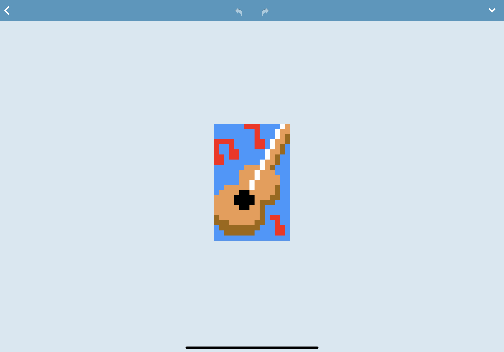

<!-- Generated by scripts/build.py. Do not edit by hand. -->

# Link-a-Pix

11 weeks archived. [Back to the archive](../)

## 2026

<table>
<tr>
<td align="center"><a href="2026-10-30/"> 2026-10-30</a></td>
</tr>
</table>

## 2022

<table>
<tr>
<td align="center"><a href="2022-05-20/"> 2022-05-20</a></td>
<td align="center"><a href="2022-04-29/"> 2022-04-29</a></td>
<td align="center"><a href="2022-04-22/"> 2022-04-22</a></td>
<td align="center"><a href="2022-04-15/"> 2022-04-15</a></td>
<td align="center"><a href="2022-04-08/"> 2022-04-08</a></td>
</tr>
<tr>
<td align="center"><a href="2022-04-01/"> 2022-04-01</a></td>
<td align="center"><a href="2022-01-07/"> 2022-01-07</a></td>
</tr>
</table>

## 2021

<table>
<tr>
<td align="center"><a href="2021-12-31/"> 2021-12-31</a></td>
<td align="center"><a href="2021-12-24/"> 2021-12-24</a></td>
<td align="center"><a href="2021-12-17/"> 2021-12-17</a></td>
</tr>
</table>
